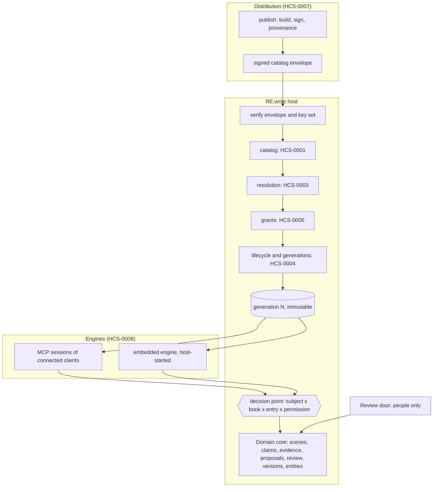

# Architecture: RE;write as an HCS host

Status: proposed with [ADR-0001](adr/0001-adopt-hcs.md). Work is tracked in [roadmap.md](roadmap.md).

RE;write is a host in the sense of the Harness Composition Specification (HCS): it reads a catalog of packages, resolves and activates them, grants them authority, and projects them into the engines its users work with. The writing domain is the host's own core. This page says what is core, what is a package, how a package reaches an engine, and where each planned feature fits.

## 1. Layers

| Layer | HCS documents | RE;write milestone |
| --- | --- | --- |
| Conventions, ids, extension namespace | HCS-0000, HCS-0002 | M1 |
| Catalog, resolution, lifecycle, typed errors | HCS-0001, HCS-0003, HCS-0004, HCS-0006 | M2 |
| Authority | HCS-0005 | M3 |
| Signed distribution | HCS-0007 (DISTRO-1) | M4 |
| Projection into engines | HCS-0008 (Provisional) | M5 |
| Observability | HCS-0004 section 4, HCS-0007-R021 | M6 |
| Conformance | HCS-0000 section 8, profiles CORE-0 and DISTRO-1 | M7 |

## 2. Host core versus packages

The rule: **what defines truth or decides is host core; what analyses, suggests or connects is a package.**

| Part | Where | Why |
| --- | --- | --- |
| Scenes, revisions, anchors and evidence status | core | Evidence status is derived on every read and must never depend on optional code |
| Claims, editorial and evidence states, canon query | core | Canon is a query over core state, not something a package can set |
| Proposals and review (accept, reject, verdicts) | core, review door only | Human approval is a host-owned boundary (section 5) |
| Manuscript versions, narrative entities, events, timeline | core | Shared model every package reads; one definition |
| Access: people to books | core | Composed with package grants in one decision point (section 5) |
| Claim extractors (fixture annotations today, agent-driven later) | package, kind `x-rewrite-extractor` | Several can exist; output goes through the same literal-quote check |
| Continuity rules (knowledge order today) and craft diagnostics | package, kind `x-rewrite-check` | Heuristics that produce findings, never verdicts |
| Importers and exporters (for example a notes workspace) | package, kind `x-rewrite-importer` | Bring outside material in as proposals only |
| Procedures for agents (how to extract, how to propose, onboarding now in `/llms.txt`) | package, kind `skill` | Agent Skills as is |
| Standing instructions for agents (the untrusted-text rules) | host-owned instructions, plus packages of kind `x-rewrite-instructions` that may only narrow | AGENTS.md convention; extension kind until HCS promotes it |
| External tools an agent may use (for example a notes workspace MCP server) | package, kind `mcp-server` | MCP Registry `server.json`, secrets only from grants |

See [contribution kinds and module classification](contributions.md) for the per-module mapping, contracts and first packages. Extension kinds follow HCS-0001 section 3.2: `path` points inside the unpacked package; each kind has a small contract.

- `x-rewrite-extractor`: a module or declarative file that, given a scene, returns `ClaimCandidate` objects. Requests `com.fullfran.rewrite.book.read` and `com.fullfran.rewrite.claims.propose`.
- `x-rewrite-check`: rules that, given claims and the narrative model, return findings with alternatives. Requests `com.fullfran.rewrite.book.read` and `com.fullfran.rewrite.findings.propose`.
- `x-rewrite-importer`: maps outside records to proposals; never writes canon. Requests `com.fullfran.rewrite.book.import`.
- `x-rewrite-instructions`: Markdown in the AGENTS.md convention; may only add restrictions.

## 3. Identifiers

Capabilities are named by contract, not by package (HCS-0002). Host built-ins are provided by RE;write itself; packages require them.

| Capability | Major | Provider | Contract and MCP tools today |
| --- | --- | --- | --- |
| `com.fullfran.rewrite.book.read@1` | 1 | host | Read books and scenes: `list_books`, `list_scenes`, `read_scene` |
| `com.fullfran.rewrite.claims.read@1` | 1 | host | Read claims: `list_claims` |
| `com.fullfran.rewrite.claims.propose@1` | 1 | host | Propose claims: `propose_claims` |
| `com.fullfran.rewrite.revision.propose@1` | 1 | host | Propose revisions and inspect proposals: `propose_revision`, `list_proposals`, `get_proposal` |
| `com.fullfran.rewrite.continuity.check@1` | 1 | host, until extraction to `com.fullfran.rewrite.knowledge-order` | Inspect continuity: `inspect_continuity` |
| `com.fullfran.rewrite.findings.read@1` | 1 | host | Read narrative findings and analysis guide: `list_findings`, `get_analysis_guide` |
| `com.fullfran.rewrite.findings.propose@1` | 1 | host | Propose narrative findings: `propose_findings` |
| `com.fullfran.rewrite.claims.extract@1` | 1 | package (`x-rewrite-extractor`) | Extract claim candidates: none yet (CLI `extract`) |
| `com.fullfran.rewrite.entities.read@1` | 1 | host (planned, [#12](https://github.com/FullFran/re-write/issues/12)) | Read entities: none yet |
| `com.fullfran.rewrite.events.read@1` | 1 | host (planned, [#15](https://github.com/FullFran/re-write/issues/15)) | Read events: none yet |

| Permission | Allows | Grantable to an entry |
| --- | --- | --- |
| `com.fullfran.rewrite.book.read` | Read books and scenes | yes |
| `com.fullfran.rewrite.book.create` | Create a book repository and become its initial member (review door only) | no |
| `com.fullfran.rewrite.book.import` | Import outside records as proposals (MCP) or scenes directly (review door) | yes |
| `com.fullfran.rewrite.claims.propose` | Propose claims | yes |
| `com.fullfran.rewrite.findings.propose` | Propose findings | yes |
| `com.fullfran.rewrite.revision.propose` | Propose revisions | yes |
| `com.fullfran.rewrite.review.decide` | Accept or reject through the review door only | no |

Extension members are `x-rewrite-*`. Product refusals (quote not literal, stale evidence, unknown book) are not HCS errors; they are RFC 9457 problem types under a URI RE;write owns (HCS-0006 section 3).

## 4. Engines and generations

A **generation** is the immutable, prepared set of packages of one desired set (HCS-0008 section 2). A pointer selects the generation for new runs; it is switched as one step after the whole set is prepared.

| Engine | Started by RE;write | How a generation reaches it | HCS-0008 |
| --- | --- | --- | --- |
| Connected MCP clients (ChatGPT, Claude Code, OpenCode, others) | no | Each MCP session's tools, prompts, instructions and skill resources are built from one generation, fixed for the session's life | by analogy: R001-R007, R017; health = first successful call. This case is a gap in HCS, reported there |
| Embedded engine for writers without their own agent (Pi first) | yes | A per-run projection that points at the generation directory, with RE;write's MCP server as a host-owned server | applies fully, including R013-R016 |

MCP sessions currently expose host built-ins from one capability snapshot pinned when the server is built, and check capability state on dispatch. Package projection into sessions awaits M5.

The model comes from the connected client; only the embedded engine needs one paid by the operator, chosen from a host-owned allowlist ([#5](https://github.com/FullFran/re-write/issues/5)).

## 5. Authority and the review boundary

An operation is allowed only when all of these hold, checked when it is dispatched (HCS-0005-R003):

1. the person (subject from OAuth) may use the book;
2. the package entry, if the operation comes from a package, holds a grant for the permission;
3. the operation is reachable through the door it arrived on.

One function decides this: `decide({ subject, book, door, permission, entry })` in `src/application/decision.ts`. Every MCP tool and every review route that touches a book calls it before doing any work, and it reads people's book access (`access.json`) and package grants (`grants.json`) from disk on every call, so `rewrite revoke` and `rewrite package-revoke` apply to the next call without a restart. A person without access to a book gets the same refusal as for a missing book; a package without a grant gets `permission_denied` (HCS-0005-R001); a permission the door does not offer is `forbidden`. Requests and contribution metadata such as Agent Skills `allowed-tools` never count as grants (HCS-0005-R002, R004).

There are two doors. The MCP door can read and propose. The review door, behind a browser session, is the only way to accept or reject, and provides the writer workspace where authors create books, import Markdown, and inspect scenes without terminal access.

Routes available on the review door (`/review`):
- `GET /review/api/books`: lists accessible books (`com.fullfran.rewrite.book.read`).
- `POST /review/api/books`: creates a book and grants access to the creator (`com.fullfran.rewrite.book.create`).
- `GET /review/api/books/{book}`: reads the review queue and scene list (`com.fullfran.rewrite.book.read`). The answer carries an `ETag`; a request with a matching `If-None-Match` gets `304` with no body. The review page uses this to poll every 5 seconds while its tab is visible, and authorization is still checked on every poll.
- `GET /review/api/books/{book}/findings`: reads narrative findings with current evidence status (`com.fullfran.rewrite.book.read`).
- `GET /review/api/books/{book}/export`: downloads findings with ratings and notes as JSON (`com.fullfran.rewrite.book.read`).
- `GET /review/api/books/{book}/scenes`: lists scene files in the book (`com.fullfran.rewrite.book.read`).
- `GET /review/api/books/{book}/scenes/{file}`: reads a scene text and lists its pending proposals and citing findings (`com.fullfran.rewrite.book.read`).
- `POST /review/api/books/{book}/import`: uploads and commits Markdown scenes (`com.fullfran.rewrite.book.import`).
- `POST /review/api/books/{book}/claims/{id}`, `/proposals/{id}`, `/findings/{id}`: reviews claims, proposals, and findings (`com.fullfran.rewrite.review.decide`).

Review decisions (`com.fullfran.rewrite.review.decide`) and book creation (`com.fullfran.rewrite.book.create`) are never grantable to a package, and the MCP door refuses them whatever is granted. That is a host-owned setting: generation content cannot add an approve tool, remove the untrusted-text instruction or widen it (HCS-0008-R007). Per-person credentials for projected MCP servers follow [#4](https://github.com/FullFran/re-write/issues/4).

Book creation retains one accepted existence signal: an occupied name returns
HTTP 409, identically for members and non-members, with only
“Ese nombre de libro no está disponible; elige otro título.” The response never
echoes the slug or identifies the owner. A refusal is unavoidable because book
slugs are globally unique; it does not grant access to the existing book.

## 6. Where the planned features fit

| Issue | Feature | Fit |
| --- | --- | --- |
| [#11](https://github.com/FullFran/re-write/issues/11) | Re-anchoring and reopening decisions | core, review door only; reopening is a review action |
| [#12](https://github.com/FullFran/re-write/issues/12) | Entities and relationships | core model; read through new `entities.read@1` capability; relationship suggestions from packages are proposals |
| [#13](https://github.com/FullFran/re-write/issues/13) | Manuscript versions and canon | core; a manuscript version is not an HCS generation (different things, different names) |
| [#14](https://github.com/FullFran/re-write/issues/14) | Character, reader and narrator knowledge | core model for knowledge records; detection rules ship as `x-rewrite-check` packages |
| [#15](https://github.com/FullFran/re-write/issues/15) | Timeline and events | core model; ordering suggestions are proposals |
| [#16](https://github.com/FullFran/re-write/issues/16) | Import and export with a notes workspace | `x-rewrite-importer` package plus optional `mcp-server`; per-person credentials ([#4](https://github.com/FullFran/re-write/issues/4)) |
| [#17](https://github.com/FullFran/re-write/issues/17) | Writer workspace | host core UI on the review door; not a package |
| [#18](https://github.com/FullFran/re-write/issues/18) | Evidence search and finding history | core queries exposed as MCP tools; verdict history on the review door |
| [#19](https://github.com/FullFran/re-write/issues/19) | Scene planning and craft diagnostics | exploratory; diagnostics ship as `x-rewrite-check` packages |
| [#1](https://github.com/FullFran/re-write/issues/1), [#2](https://github.com/FullFran/re-write/issues/2), [#3](https://github.com/FullFran/re-write/issues/3) | Backup and isolation, review end to end, extraction evaluation | operations (M3), core review (P1), extractor packages (P1) |

## Metadata request logging

`src/adapters/request-log.ts` wraps the HTTP handler and observes the MCP transport boundary through `src/adapters/mcp.ts`. An async request context correlates both records with the generated `x-request-id`; subjects enter it only after token verification. A closed metadata allowlist excludes bodies, concrete paths, unknown tool names, and free-text errors. Subject and book identifiers are short HMAC-SHA256 pseudonyms keyed by `REWRITE_LOG_SALT`, never raw ids; missing salt disables identifier correlation rather than falling back to a plain hash.

Each HTTP request and each JSON-RPC call emits a JSON line to stdout, including known problem types or HCS error codes, never their messages or details. See [deployment: reading the log](deployment.md#read-the-metadata-request-log) for fields, salt configuration and commands. This implements an initial `metadata`-only diagnostic surface for [#42](https://github.com/FullFran/re-write/issues/42), following the privacy boundary in [#6](https://github.com/FullFran/re-write/issues/6); the broader OpenTelemetry and lifecycle profile remains planned.

## 7. What does not change

Evidence status stays derived, never stored. Canon stays a query. Ids stay content-derived. Book state stays in the book repository. Text changes only on a human accept, in the same commit as the decision.
