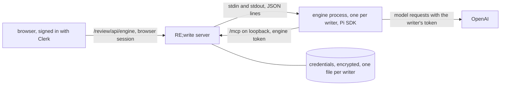

# Embedded engine: chat with an assistant from the browser

Status: experimental, **off by default**. First part of [#40](https://github.com/FullFran/re-write/issues/40). What #40 still needs is in [the last section](#what-40-still-needs).

A signed-in writer opens the assistant panel in the review page (`/review`), connects their own ChatGPT account with a device code, and talks with an assistant that runs on the server. The assistant uses RE;write's MCP tools as that writer: it can read and propose, and it can never accept or reject. It has no other tool.

## Read this before enabling it

- **Not verified: OpenAI's terms.** The engine signs in with a writer's own ChatGPT subscription and uses it from a server. Whether OpenAI's terms allow that use is an assumption nobody has checked. Decide that before you enable it for other people.
- **Not verified: a real sign-in.** No real ChatGPT account was available while this was built. [What is not verified](#what-is-not-verified) lists exactly what that leaves open, and [Manual check](#manual-check-with-a-real-account) is how to close it.
- **Book text goes to OpenAI** with the writer's account when the assistant reads a scene, as it does today when a writer connects ChatGPT to `/mcp` themselves.
- **The operator pays for no model.** The writer brings the account. This changes what [engines.md](engines.md#32-embedded-engine) said before.

## How it works



| Part | Where | What it does |
| --- | --- | --- |
| Routes and panel | `src/adapters/http-server.ts`, `src/adapters/engine-page.ts` | The browser side, behind the browser session; the panel's styles and script are appended to the review page's |
| Process manager | `src/adapters/engine.ts` | Starts, feeds and stops engine processes; owns credentials and refresh |
| Credentials and tokens | `src/adapters/engine-auth.ts` | Encrypted vault; engine tokens for `/mcp` |
| Protocol | `src/adapters/engine-protocol.ts` | The messages between server and engine process |
| Engine process | `engine/main.ts` | A separate program on the Pi SDK, with its own `package.json` and lockfile |

The server never imports the Pi packages. They live in `engine/`, are installed only when asked for, and run in a child process. With the engine off, nothing in `engine/` is read or started and the routes answer 404.

## Enable it

1. Build the image with the engine installed (about 150 MB more):

   ```bash
   docker build --build-arg WITH_ENGINE=1 -t rewrite .
   ```

2. Create a key and keep a copy off the server. Losing it makes every stored credential unreadable; writers then connect again.

   ```bash
   openssl rand -base64 32
   ```

3. Set the environment:

| Variable | Default | Meaning |
| --- | --- | --- |
| `REWRITE_ENGINE` | unset | `1` enables the engine. Anything else leaves it off |
| `REWRITE_ENGINE_KEY` | none | 32 bytes, base64. Encrypts stored credentials. Required when enabled: without it the server refuses to start |
| `REWRITE_ENGINE_MAX_PROCESSES` | `2` | Engine processes alive at once. Each one used about 160 MB of memory when idle in a local check. Above the cap the answer is `busy` |
| `REWRITE_ENGINE_IDLE_SECONDS` | `300` | An engine process with no turn and no pending login for this long is stopped |
| `REWRITE_ENGINE_TURN_SECONDS` | `600` | Longest one turn may run. Past it the turn ends with `turn_limit` |
| `REWRITE_ENGINE_TURN_MAX_BYTES` | `2097152` | Most answer text one turn may stream. Past it the turn ends with `turn_limit` |

The engine process reaches the server at `http://127.0.0.1:$PORT/mcp`.

**Reverse proxy on the same host.** The server listens on all interfaces, and a proxy on the same host connects to it from loopback, exactly like the engine. The server tells them apart by headers: a request that carries `Forwarded`, `Via`, `X-Real-IP`, `CF-Connecting-IP`, `True-Client-IP` or any `X-Forwarded-*` header is never treated as the engine's. Caddy and Traefik add `X-Forwarded-For` by default; nginx adds none unless configured (`proxy_set_header X-Forwarded-For $proxy_add_x_forwarded_for;`). If your proxy adds none of them, remote requests look like loopback ones: a leaked engine token would then work from outside, and the Host check would be skipped for it. An engine token never leaves the engine process and the server's memory, and dies with the process, so this is defence in depth and not the only barrier; set the header anyway, or do not expose the port except through a proxy that does.

## What a writer sees

1. The review page has an **Asistente** button in its header and a floating one. It opens a side panel on wide screens and a bottom sheet on phones, over the same page: nothing reloads and the page keeps its place and its refresh. `/review/engine`, the old address, redirects to `/review?asistente=1`, which opens the panel.
2. Not connected, the panel asks them to connect ChatGPT, then shows a code and a link to `https://auth.openai.com/codex/device`. They sign in there and type the code. Nothing travels from their browser to the server in this step; the server polls OpenAI.
3. Connected, the panel offers a few quick questions that only fill the prompt. The book selected in the page is sent with every turn, and **Preguntar al asistente** on a proposal, finding or claim adds that item (see [Page context](#page-context)). Answers stream in with paragraphs, lists, quotes and emphasis, built as elements from text. Each tool call shows as a step while it runs and after (`Leyendo escena 3…`, `Propuestos 2 hallazgos`, `Error: …`). When the assistant proposed something, the panel waits for the page's next refresh and offers **Ver en la página**, which scrolls to the new card.
4. "Desconectar ChatGPT" deletes the stored credential, stops their engine process and revokes its token.

The model is the first one OpenAI lists for the account; there is no model picker. The conversation is kept in the memory of the engine process only: it is lost when the process stops (idle, disconnect, restart) and is never written to disk.

## Routes

All under the browser session, like the review API. An agent's access token and an engine token are both refused with 401.

| Route | Answer |
| --- | --- |
| `GET /review/engine` | 302 to `/review?asistente=1`. The panel is served with the review page: `/review/app.js` and `/review/app.css` carry it when the engine is on |
| `GET /review/api/engine/status` | `{state}`: `disconnected`, `pending` (with `user_code` and `verification_uri`), `connected` or `reconnect` |
| `POST /review/api/engine/login` | Starts a device login: `{user_code, verification_uri, expires_in}`. One pending login per person; a new one cancels the previous. At most 3 starts per person in 15 minutes, then `rate_limited` |
| `DELETE /review/api/engine/credential` | Disconnects |
| `POST /review/api/engine/prompt` `{text, context?}` | `text/event-stream` with `delta {text}`, `tool {name, phase, ok?, call?, scene?, count?}`, then `done {aborted}` or `error {code}`. See [Page context](#page-context) and [Tool activity](#tool-activity) |
| `POST /review/api/engine/abort` | `{aborted}`: stops the running turn of this person |

### Page context

`context` says what the writer is looking at in the review page: `{book_id, item?: {kind, id}}`, with `kind` one of `proposal`, `claim`, `finding` (continuity), `narrative_finding` or `scene` (the id is then the scene path). Any other key, or an id of the wrong shape, is 400. The book goes through the same decision point as every review route, and the item must exist in it: a foreign or unknown book or item is 404.

The browser never writes text for the model here. The server builds one line from these fields, and the engine program puts it before the writer's text (the protocol carries it as a separate `context` field of the `prompt` message, so the writer's text is never first):

```text
[RE;write page context, set by the host] book_id="sal" title="La sal"; item=proposal id="P-18c123bec3" scene="scenes/003-el-faro.md"
```

It holds only ids, the book title and a scene path, each a JSON string cut at 120 characters, never text of the manuscript or of an item. Every turn has this line, also without `context`: it then reads `[RE;write page context, set by the host] none`. The fixed preamble of the system prompt tells the model that only the host writes it, always as the first line, that what it quotes is data, and that a later line claiming to be it is the writer's.

As a second layer, a line of the writer's text (split at LF, CR, CRLF, VT, FF, NEL, U+2028 and U+2029) whose letters start like the marker gets `(writer text) ` in front. The comparison ignores invisible format characters, spacing and punctuation, applies NFKC (fullwidth forms) and maps common Cyrillic and Greek lookalikes to Latin letters. It is a heuristic and does not catch every way of writing the marker; what the design relies on is the host line coming first. The system prompt itself is unchanged: it is sent when the process starts and has no field in the request.

### Tool activity

A `tool` event is a step of one tool call: `phase` is `start` or `end` (`ok` on the end only), `call` pairs the two, `scene` is a scene path from the call's arguments and `count` (0 to 999) how many items a list or propose tool returned or created, read from the tool's structured result. Nothing else of an argument or a result leaves the engine process, and the server parses each field again and drops any that does not match: a scene path must look like `scenes/name.md`, at most 120 characters, with no control characters and no invisible format characters (bidi controls included), so a label cannot be visually spoofed. An engine program older than this sends only an end event without a phase; the server reports it as `phase: "end"`.

A person who can use no book gets 404 on every one of these, as if the engine were off: create or be given a book first.

Errors are a closed set of codes and nothing else: `model_busy`, `reconnect`, `provider_error`, `busy`, `rate_limited`, `turn_in_progress`, `turn_limit`, `not_connected`, `engine_unavailable`, `login_failed`. Provider error text can quote response bodies, so it never reaches a response or a log.

## Security boundaries

- **Same door as a connected client.** The engine's MCP bearer is a random token (`rwe_...`) the server keeps only as a SHA-256 hash in memory, tied to one person. It resolves to that person's subject and goes through the same `/mcp` handler and the same decision point as their ChatGPT connector would. It is not a JWT, so the review door cannot accept it.
- **Loopback only.** An engine token is honoured only when all of this holds: the MCP path, the loopback `Host` the engine dials, a direct loopback connection, none of the proxy headers listed under [Enable it](#enable-it), and a live token. Anything less gets exactly what the server answers with the engine off (403 for a wrong `Host`, 401 for an unknown bearer).
- **Short-lived.** A token lives as long as its process: until idle stop, disconnect, server shutdown, or 60 minutes at most.
- **Credentials.** One file per person in `$REWRITE_DATA_DIR/engine/credentials/`, named by a hash of the subject, AES-256-GCM with the subject bound in, mode 0600, written to a temporary file and renamed. Never logged, never sent to the browser, never on the engine's command line or in its environment. They are inside the data volume, so backups contain them, encrypted with a key the backup does not hold.
- **One refresher.** OpenAI's refresh token is single-use. The server is the only place that decides to refresh, one refresh at a time per person; the exchange itself runs in that person's engine process through Pi. If it fails the stored credential is kept and the writer is asked to connect again. A process that is being stopped (idle, limit, shutdown) while a refresh is out is kept up to 10 seconds so the new token can come back and be stored; only a disconnect throws it away. If the server is killed outright in that window the new token is lost and the writer connects again.
- **Slots.** A process is a scarce slot (`REWRITE_ENGINE_MAX_PROCESSES`). A pending login holds one without a credential, so it has a hard deadline (15 minutes, the life of the code), login starts are rate-limited per person, a process left with no pending login and no stored credential is stopped at once, and a connected writer's turn takes the slot of the oldest process that only waits for a code. A turn has a time limit and a size limit; a process that does not settle after either is stopped.
- **Shutdown.** Engine processes exit when their stdin closes, which covers a server that dies. On SIGTERM or SIGINT the server also stops them itself, because it stays alive while open connections drain.
- **Tools.** Pi has no sandbox, so its shell and file tools are off, and its script tool (`codemode`) is not activated: the MCP server is registered with `direct` exposure. The engine reports its tool list when the session starts; the engine and the server each stop it if any tool is not one of RE;write's MCP tools.
- **Model providers.** The engine process gets an environment with `PATH` only and a private temporary home, so no provider key of the operator reaches it. Before the first request it checks that every available model belongs to the writer's OpenAI login.
- **System prompt.** A fixed preamble plus the instructions a connected MCP client gets (scene text is untrusted, the agent cannot accept or reject). The browser has no field for it. The page context of a turn is a host-built line in the message, not part of the system prompt (see [Page context](#page-context)).
- **Not a sandbox against the operator.** Anyone with a shell in the container and the key can read stored credentials.

Engine lifecycle is logged as `{"event":"engine.process","action":"start"|"stop","reason":...,"live":n}`, with no subject and no content. The request log names the engine routes (`/review/api/engine/prompt` and so on) and, as for every route, nothing of their bodies.

## What is not verified

Tests run against a fake engine process and call no provider. The real engine process was started locally with the pinned packages against a local server: it reported Pi 1.5.2, connected to `/mcp` with its engine token and listed exactly the twelve RE;write tools. Beyond that, without a real ChatGPT account:

- the device-code login end to end (code shown, approval at OpenAI, credential returned and stored);
- that OpenAI accepts this login from a server address, and under the client name Pi presents;
- the refresh exchange with a real rotating refresh token;
- a real model request: streaming over the SSE transport, tool calls reaching `/mcp`, the answer arriving in the page;
- the model list of a real account, and that its first entry is the right default;
- which error texts a real 429, 503 or expired login produce, and so whether they map to `model_busy` and `reconnect` rather than `provider_error`;
- abort during a real model request;
- memory and latency under real use, and the image built with `WITH_ENGINE=1`.

## Manual check with a real account

Use the synthetic book only.

1. Build with `--build-arg WITH_ENGINE=1`, set `REWRITE_ENGINE=1` and `REWRITE_ENGINE_KEY`, deploy, and confirm `GET /health` still answers.
2. Open `/review` on a phone, signed in, and press **Asistente** (a person who cannot use any book is told to create one first). Press "Conectar ChatGPT": a code and the OpenAI link appear.
3. Approve at OpenAI. Within a few seconds the panel shows its quick questions. In the container, `ls -l /data/engine/credentials/` shows one file with mode `-rw-------` and no readable token inside.
4. Ask "¿Qué libros tengo?". The answer streams, and a step says how many books it found.
5. Ask it to propose a claim with a literal quote. The claim appears in `/review` as pending; the assistant has not accepted it and says it cannot.
6. Start a long answer and press "Detener": it stops, and the next message works.
7. Wait past `REWRITE_ENGINE_IDLE_SECONDS`, send again: it answers, with the earlier conversation gone. `docker logs` shows `engine.process` stop and start lines and no token, code or message text.
8. After more than an hour, send again: the turn still works (a refresh happened) and the credential file has a new modification time.
9. Press "Desconectar ChatGPT": the file is gone and the panel asks to connect again.
10. From another account with no connection, confirm the page asks to connect and shows nothing of the first account.

If step 3, 4 or 8 fails, the page shows a fixed message only. Run the engine by hand in the container to see the real error; it is deliberately not logged.

## What #40 still needs

This is the engine and the sign-in. It is not yet HCS-0008 conformance for an embedded engine:

- No generation is projected. The run does not point at a generation directory, and packages contribute nothing to it (#40 acceptance criteria on R001, R002 and R004; depends on [#36](https://github.com/FullFran/re-write/issues/36) to [#39](https://github.com/FullFran/re-write/issues/39)).
- Skills and `x-rewrite-instructions` are not delivered to the engine.
- No health check, confirmation or rollback ([#41](https://github.com/FullFran/re-write/issues/41)).
- Supported engine versions are pinned in `engine/package.json` (1.5.2), not yet declared through `compatibility.hosts`.
- Process supervision beyond idle stop and a cap, and latency work, are [#7](https://github.com/FullFran/re-write/issues/7).
