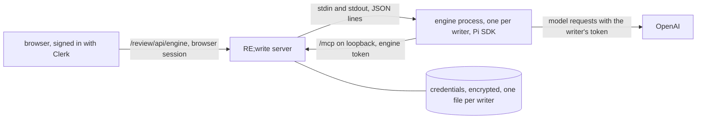

# Embedded engine: chat with an assistant from the browser

Status: experimental, **off by default**. First part of [#40](https://github.com/FullFran/re-write/issues/40). What #40 still needs is in [the last section](#what-40-still-needs).

A signed-in writer opens `/review/engine`, connects their own ChatGPT account with a device code, and talks with an assistant that runs on the server. The assistant uses RE;write's MCP tools as that writer: it can read and propose, and it can never accept or reject. It has no other tool.

## Read this before enabling it

- **Not verified: OpenAI's terms.** The engine signs in with a writer's own ChatGPT subscription and uses it from a server. Whether OpenAI's terms allow that use is an assumption nobody has checked. Decide that before you enable it for other people.
- **Not verified: a real sign-in.** No real ChatGPT account was available while this was built. [What is not verified](#what-is-not-verified) lists exactly what that leaves open, and [Manual check](#manual-check-with-a-real-account) is how to close it.
- **Book text goes to OpenAI** with the writer's account when the assistant reads a scene, as it does today when a writer connects ChatGPT to `/mcp` themselves.
- **The operator pays for no model.** The writer brings the account. This changes what [engines.md](engines.md#32-embedded-engine) said before.

## How it works



| Part | Where | What it does |
| --- | --- | --- |
| Routes and page | `src/adapters/http-server.ts`, `src/adapters/engine-page.ts` | The browser side, behind the browser session |
| Process manager | `src/adapters/engine.ts` | Starts, feeds and stops engine processes; owns credentials and refresh |
| Credentials and tokens | `src/adapters/engine-auth.ts` | Encrypted vault; engine tokens for `/mcp` |
| Protocol | `src/adapters/engine-protocol.ts` | The messages between server and engine process |
| Engine process | `engine/main.ts` | A separate program on the Pi SDK, with its own `package.json` and lockfile |

The server never imports the Pi packages. They live in `engine/`, are installed only when asked for, and run in a child process. With the engine off, nothing in `engine/` is read or started and the routes answer 404.

## Enable it

1. Build the image with the engine installed (about 150 MB more):

   ```bash
   docker build --build-arg WITH_ENGINE=1 -t rewrite .
   ```

2. Create a key and keep a copy off the server. Losing it makes every stored credential unreadable; writers then connect again.

   ```bash
   openssl rand -base64 32
   ```

3. Set the environment:

| Variable | Default | Meaning |
| --- | --- | --- |
| `REWRITE_ENGINE` | unset | `1` enables the engine. Anything else leaves it off |
| `REWRITE_ENGINE_KEY` | none | 32 bytes, base64. Encrypts stored credentials. Required when enabled: without it the server refuses to start |
| `REWRITE_ENGINE_MAX_PROCESSES` | `2` | Engine processes alive at once. Each one used about 160 MB of memory when idle in a local check. Above the cap the answer is `busy` |
| `REWRITE_ENGINE_IDLE_SECONDS` | `300` | An engine process with no turn and no pending login for this long is stopped |

The engine process reaches the server at `http://127.0.0.1:$PORT/mcp`. If a reverse proxy sits in front of the server, it must set `X-Forwarded-For`, `Forwarded` or `X-Real-IP` on what it forwards (nginx and Caddy do by default with the usual configuration): that is how the server tells a proxied request from the engine's own.

## What a writer sees

1. `/review/engine` asks them to connect ChatGPT.
2. The page shows a code and a link to `https://auth.openai.com/codex/device`. They sign in there and type the code. Nothing travels from their browser to the server in this step; the server polls OpenAI.
3. The page turns into a chat. Answers stream in. A small note names each tool the assistant used.
4. "Desconectar ChatGPT" deletes the stored credential, stops their engine process and revokes its token.

The model is the first one OpenAI lists for the account; there is no model picker. The conversation is kept in the memory of the engine process only: it is lost when the process stops (idle, disconnect, restart) and is never written to disk.

## Routes

All under the browser session, like the review API. An agent's access token and an engine token are both refused with 401.

| Route | Answer |
| --- | --- |
| `GET /review/engine`, `/review/engine/app.js`, `/review/engine/app.css` | The page |
| `GET /review/api/engine/status` | `{state}`: `disconnected`, `pending` (with `user_code` and `verification_uri`), `connected` or `reconnect` |
| `POST /review/api/engine/login` | Starts a device login: `{user_code, verification_uri, expires_in}`. One pending login per person; a new one cancels the previous |
| `DELETE /review/api/engine/credential` | Disconnects |
| `POST /review/api/engine/prompt` `{text}` | `text/event-stream` with `delta {text}`, `tool {name, ok}`, then `done {aborted}` or `error {code}` |
| `POST /review/api/engine/abort` | `{aborted}`: stops the running turn of this person |

Errors are a closed set of codes and nothing else: `model_busy`, `reconnect`, `provider_error`, `busy`, `turn_in_progress`, `not_connected`, `engine_unavailable`, `login_failed`. Provider error text can quote response bodies, so it never reaches a response or a log.

## Security boundaries

- **Same door as a connected client.** The engine's MCP bearer is a random token (`rwe_...`) the server keeps only as a SHA-256 hash in memory, tied to one person. It resolves to that person's subject and goes through the same `/mcp` handler and the same decision point as their ChatGPT connector would. It is not a JWT, so the review door cannot accept it.
- **Loopback only.** An engine token is honoured only on a direct loopback connection with no proxy header. From anywhere else it gets the same 401 as an unknown token.
- **Short-lived.** A token lives as long as its process: until idle stop, disconnect, server shutdown, or 60 minutes at most.
- **Credentials.** One file per person in `$REWRITE_DATA_DIR/engine/credentials/`, named by a hash of the subject, AES-256-GCM with the subject bound in, mode 0600, written to a temporary file and renamed. Never logged, never sent to the browser, never on the engine's command line or in its environment. They are inside the data volume, so backups contain them, encrypted with a key the backup does not hold.
- **One refresher.** OpenAI's refresh token is single-use. The server is the only place that decides to refresh, one refresh at a time per person; the exchange itself runs in that person's engine process through Pi. If it fails the stored credential is kept and the writer is asked to connect again.
- **Tools.** Pi has no sandbox, so its shell and file tools are off, and its script tool (`codemode`) is not activated: the MCP server is registered with `direct` exposure. The engine reports its tool list when the session starts; the engine and the server each stop it if any tool is not one of RE;write's MCP tools.
- **Model providers.** The engine process gets an environment with `PATH` only and a private temporary home, so no provider key of the operator reaches it. Before the first request it checks that every available model belongs to the writer's OpenAI login.
- **System prompt.** A fixed preamble plus the instructions a connected MCP client gets (scene text is untrusted, the agent cannot accept or reject). The browser has no field for it.
- **Not a sandbox against the operator.** Anyone with a shell in the container and the key can read stored credentials.

Engine lifecycle is logged as `{"event":"engine.process","action":"start"|"stop","reason":...,"live":n}`, with no subject and no content.

## What is not verified

Tests run against a fake engine process and call no provider. The real engine process was started locally with the pinned packages against a local server: it reported Pi 1.5.2, connected to `/mcp` with its engine token and listed exactly the twelve RE;write tools. Beyond that, without a real ChatGPT account:

- the device-code login end to end (code shown, approval at OpenAI, credential returned and stored);
- that OpenAI accepts this login from a server address, and under the client name Pi presents;
- the refresh exchange with a real rotating refresh token;
- a real model request: streaming over the SSE transport, tool calls reaching `/mcp`, the answer arriving in the page;
- the model list of a real account, and that its first entry is the right default;
- which error texts a real 429, 503 or expired login produce, and so whether they map to `model_busy` and `reconnect` rather than `provider_error`;
- abort during a real model request;
- memory and latency under real use, and the image built with `WITH_ENGINE=1`.

## Manual check with a real account

Use the synthetic book only.

1. Build with `--build-arg WITH_ENGINE=1`, set `REWRITE_ENGINE=1` and `REWRITE_ENGINE_KEY`, deploy, and confirm `GET /health` still answers.
2. Open `/review/engine` on a phone, signed in. Press "Conectar ChatGPT": a code and the OpenAI link appear.
3. Approve at OpenAI. Within a few seconds the page becomes a chat. In the container, `ls -l /data/engine/credentials/` shows one file with mode `-rw-------` and no readable token inside.
4. Ask "¿Qué libros tengo?". The answer streams, and a note says `Consultado: list_books`.
5. Ask it to propose a claim with a literal quote. The claim appears in `/review` as pending; the assistant has not accepted it and says it cannot.
6. Start a long answer and press "Detener": it stops, and the next message works.
7. Wait past `REWRITE_ENGINE_IDLE_SECONDS`, send again: it answers, with the earlier conversation gone. `docker logs` shows `engine.process` stop and start lines and no token, code or message text.
8. After more than an hour, send again: the turn still works (a refresh happened) and the credential file has a new modification time.
9. Press "Desconectar ChatGPT": the file is gone and the page asks to connect again.
10. From another account with no connection, confirm the page asks to connect and shows nothing of the first account.

If step 3, 4 or 8 fails, the page shows a fixed message only. Run the engine by hand in the container to see the real error; it is deliberately not logged.

## What #40 still needs

This is the engine and the sign-in. It is not yet HCS-0008 conformance for an embedded engine:

- No generation is projected. The run does not point at a generation directory, and packages contribute nothing to it (#40 acceptance criteria on R001, R002 and R004; depends on [#36](https://github.com/FullFran/re-write/issues/36) to [#39](https://github.com/FullFran/re-write/issues/39)).
- Skills and `x-rewrite-instructions` are not delivered to the engine.
- No health check, confirmation or rollback ([#41](https://github.com/FullFran/re-write/issues/41)).
- Supported engine versions are pinned in `engine/package.json` (1.5.2), not yet declared through `compatibility.hosts`.
- Process supervision beyond idle stop and a cap, and latency work, are [#7](https://github.com/FullFran/re-write/issues/7).
- The request log names these routes `unmatched`, and the review page has no link to the chat yet.
- The page follows the plain style of the review page, not a shared design document.
