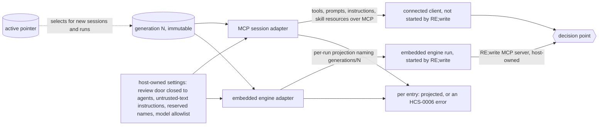

# Engine model: which engines RE;write serves and how a generation reaches each

Status: proposed with [ADR-0002](adr/0002-engine-model.md). Design for [#35](https://github.com/FullFran/re-write/issues/35); implemented by [#36](https://github.com/FullFran/re-write/issues/36) to [#41](https://github.com/FullFran/re-write/issues/41). Read against HCS `0.1.0-draft.6` (`vendor/hcs/0.1.0-draft.6/spec/HCS-0008-host-adapter.md`).

This page is a design. Nothing in it is implemented unless section 2 says so. Decisions come from the issues it cites. What no issue decides is listed in section 7 and is not decided here.

## 1. Terms

- **Generation:** the immutable, prepared set of packages of one desired set (HCS-0008 section 2). See [HCS pin and local checks](hcs.md#lifecycle-and-generations) for the directory layout.
- **Engine:** in HCS-0008, the agent runtime a host starts and configures. This page also uses the word for agents RE;write does not start, and says so each time.
- **Projection:** what an engine receives from one generation: tools, skills, MCP servers, instructions.
- **Host-owned setting:** something generation content may narrow and never replace, remove or widen (HCS-0008-R007).

## 2. What exists today

| Fact | Where |
| --- | --- |
| The MCP endpoint is stateless: one MCP server object per HTTP request, no MCP session id | `src/adapters/http-server.ts` |
| That server exposes host built-in tools from a capability snapshot taken when it is built, and one fixed instructions text. It serves no prompts and no resources | `src/adapters/mcp.ts` |
| The HTTP server is given no host state directory, so it never sees a generation. `generationCapabilities(stateDir)` exists and is not wired into it | `src/hcs/registry.ts` |
| Only the CLI reads and writes a host state directory | `src/cli/main.ts` |
| The state directory holds `active`, `status.json`, `lock` and `generations/<n>/`. It has no record of a pending, confirmed or failed generation | [hcs.md](hcs.md#lifecycle-and-generations) |
| Activation runs no package code; it only makes an entry's capabilities callable | [hcs.md](hcs.md#try-it) |
| An embedded engine exists behind a flag, off by default: one Pi process per writer, with RE;write's MCP server as its only tools. It projects no generation yet | [engine.md](engine.md), `src/adapters/engine.ts`, `engine/` |

## 3. The two engines

| Engine | Who starts it | Who supplies the model | How a generation reaches it | Unit that sees one generation |
| --- | --- | --- | --- | --- |
| Connected MCP client (ChatGPT, Claude Code, OpenCode, others) | the person, on their own machine or account | the client | RE;write builds what the MCP session sees from one generation: tools, prompts, instructions, and skills as resources | one MCP session |
| Embedded engine for writers without their own agent (Pi first) | RE;write | the writer, by signing in with their own ChatGPT account (see 3.2) | A per-run projection that points at the generation directory, with RE;write's own MCP server as a host-owned server | one engine run |

Rules that hold for both:

1. A session or a run sees exactly one generation, whole. A new generation applies to new sessions and new runs only (#36, [#40](https://github.com/FullFran/re-write/issues/40)).
2. Every contribution is projected or reported with an HCS-0006 error that names the entry. An entry is reported `active` for an engine only when all its contributions were projected there (#36).
3. A kind an engine cannot take is reported and does not fail the switch (#36, HCS-0008-R017).
4. Host-owned settings win. No generation content can add an approve tool, remove the untrusted-text instruction or widen a model list ([#37](https://github.com/FullFran/re-write/issues/37)).
5. Both engines reach book data only through the decision point of [architecture.md, section 5](architecture.md#5-authority-and-the-review-boundary). Both use the MCP door, which can read and propose and can never accept or reject.

### 3.1 Connected MCP clients

RE;write does not start these clients, cannot see their configuration and never sees their model requests. It controls only what its own MCP endpoint answers. The projection is therefore the content of the MCP session:

| Contribution | Reaches the client as | Issue |
| --- | --- | --- |
| Capabilities an entry `provides` | MCP tools, listed and callable only while the entry is `active` | #36 |
| `skill` | The Agent Skill's files, byte for byte, under its own `name`; for example MCP resources and a downloadable bundle. The onboarding text in `/llms.txt` moves into a skill | [#38](https://github.com/FullFran/re-write/issues/38) |
| `x-rewrite-instructions` | Added to the MCP `instructions`, after the host-owned text; may only add restrictions | #36, #37 |
| `mcp-server` | Not decided (section 7, Q3) | [#39](https://github.com/FullFran/re-write/issues/39) |

### 3.2 Embedded engine

RE;write starts this engine, so HCS-0008 applies as written. Each run gets a projection that names the generation directory (`generations/<n>/...`), never the `active` pointer. The run reads skills, MCP servers, instructions and the model allowlist from that projection. RE;write's own MCP server is in it as a host-owned server, so the engine has the same read-and-propose door as a connected client. Supported engine versions are pinned (#40).

**Who supplies the model (changed 2026-11-11).** This page used to say the operator supplies the model and that this is the only case where the operator pays for one. The first implementation ([engine.md](engine.md)) does the opposite: the writer signs in with their own ChatGPT account through a device code, and the operator pays for no model. The reason is cost and scope: a pilot operator should not carry a model bill per writer, and a writer who already pays for ChatGPT can use it here as they do with a connected client. The price is a per-person credential the host must store (encrypted, [engine.md](engine.md#security-boundaries)) and a dependency on OpenAI's terms for this use, which is not verified. A host-owned model allowlist (#5) therefore has nothing to restrict yet: the engine uses the first model the account lists. An operator-supplied model stays possible later and is not built.

What exists is the engine process and the sign-in. The projection described above (generation directory, skills, instructions from packages) is not built; [engine.md](engine.md#what-40-still-needs) lists what #40 still needs.

## 4. Which HCS-0008 requirements apply where

"By analogy" means: HCS-0008 does not cover the case, and RE;write adopts the rule as its own, with "MCP session" in place of "engine run". "Reading" in the last column means the row follows from the draft.6 text and from section 3, and no issue has confirmed it yet (section 7, Q8).

| Requirements | Connected MCP session | Embedded engine | Basis |
| --- | --- | --- | --- |
| R001, R002: one generation per run, never changed during it | by analogy, per MCP session | apply | #36, #40 |
| R003, R004, R005, R017: project or report; unprojectable kinds do not fail the switch | by analogy | apply | #36, #40 |
| R006: name collisions refused for both entries | by analogy, on MCP tool, prompt and skill names | apply | #37 |
| R007: host-owned settings win | by analogy | apply | #37 |
| R008, R009: skills unchanged, under their own name | by analogy: bytes served equal the unpacked bytes | apply | #38 |
| R010, R011, R012: `server.json`, no secret values, secrets only from grants | open (Q3) | apply | #39 |
| R013, R015, R016: confirm after health, one rollback, then stop | by analogy: health is a first successful tool call | apply | [#41](https://github.com/FullFran/re-write/issues/41) |
| R014: a projected skill or MCP server missing from the engine's report fails health | does not apply: a connected client reports nothing | applies if the engine reports what it loaded | #41, [roadmap.md](roadmap.md) |
| R018 (SHOULD): health is `healthy`, `unhealthy` or `unknown` | applies | applies | #41 |
| R019, R020: guard on model requests | cannot apply: the request goes from the person's client to their provider | apply only if RE;write declares such a guard (Q7) | reading |
| R021 to R024, R030: server code inside the generation, literal values | open (Q3) | apply | reading |
| R025: no ambient configuration | cannot apply: the client is the person's and reads its own configuration | applies | reading |
| R026 to R029: engines driven over ACP | do not apply: RE;write is not the ACP client of a connected client | apply only if the engine is driven over ACP (Q7) | reading |
| R031 to R035: crash-safe switch and persisted marks | host-level: they govern the pointer both engines read, not one engine | host-level | reading; placement open (Q6) |

Appendix A of HCS-0008 lists OpenCode and Claude Code as engines a host starts. RE;write does not start them, so those columns are informative only here. The Pi column is the one #40 uses; it is non-normative and was observed at one Pi version.

## 5. The HCS gap

HCS-0008 defines an engine as "the agent runtime a host starts and configures". A connected MCP client is neither started nor configured by the host. draft.6 has no rule for it. Three things are missing:

- how a generation is pinned for a client the host does not start;
- what "healthy" means when there is no engine start to observe;
- how skills and instructions reach a client that has no projected file tree.

The gap is reported as [FullFran/hcs#15](https://github.com/FullFran/hcs/issues/15) (open). Until HCS decides, the "by analogy" rows of section 4 are RE;write rules, not HCS conformance: host-level HCS-0008 cases can only be claimed for the embedded engine. HCS-0008 is Provisional and says it is superseded when MCP or Agent Skills define client-side installation; the MCP session rules here go away with it.

## 6. Out of scope

- How RE;write starts, stops, supervises or keeps warm an embedded engine process, and turn latency ([#7](https://github.com/FullFran/re-write/issues/7)).
- The vocabulary for host-owned settings and the model allowlist format (#5).
- Per-person credentials for projected MCP servers ([#4](https://github.com/FullFran/re-write/issues/4)).
- Projecting into OpenCode, Claude Code or any other engine as a host-started engine. They are served as connected clients only.
- Changing what the doors allow. Review stays with people ([ADR-0001](adr/0001-adopt-hcs.md), decision 6).
- Any change to HCS itself (FullFran/hcs#15).
- Code. This page changes no behaviour.

## 7. Open questions

Not decided by #35 or by the issues it cites. Each needs a decision before the issue named in it can be finished. Options are listed with their cost, not ranked.

**Q1. What is an "MCP session" when the endpoint is stateless?** (#36) Today there is one server per request and no session id, so there is nothing to pin a generation to.

| Option | Cost |
| --- | --- |
| Stateful sessions: issue an MCP session id at `initialize` and keep its generation in memory | The server keeps per-person state between calls, which it avoids today; sessions are lost on restart; needs expiry |
| Stay stateless and pin per request | Each request sees one whole generation, but a client can list tools from generation N and call one in N+1. #36's first acceptance criterion (a session keeps its generation across a switch) is not met as written |
| Stateless server, with the generation id carried in the session id the client sends back | No server memory, but the id must be protected against forgery and the old generation must still be on disk (Q2) |

**Q2. How long is a superseded generation kept for sessions still pinned to it?** (#36, #7) HCS-0008-R034 only obliges the host to keep the active, pending and confirmed generations. A long session pinned to an older one needs a drain rule or an end-of-session rule. HCS leaves drain open (OQ-0004-2). Does not arise if Q1 is answered "pin per request".

**Q3. How does an `mcp-server` contribution reach a connected client?** (#39) RE;write cannot make a client it does not start connect to another server.

| Option | Cost |
| --- | --- |
| Report `unsupported_contribution` for the entry on MCP sessions (R004, R017) | Integrations that ship an MCP server, such as the notes workspace of [#16](https://github.com/FullFran/re-write/issues/16), work only with the embedded engine |
| RE;write connects to the server itself and re-exposes its tools on its own MCP endpoint | RE;write becomes a gateway: it starts or dials servers, holds their secrets, owns R021 to R024 and R030, and must handle tool name collisions with its own tools (R006) |
| Give the client a descriptor to install on its side | Nothing enforces it, and secret inputs would have to leave the host, against the intent of R012 |

**Q4. How do skills reach a connected client, and when does a skill count as projected?** (#38) #38 names MCP resources and a downloadable bundle as examples, not as the decision; FullFran/hcs#15 also lists MCP prompts. MCP defines no skill installation, so the client decides whether it ever reads them. R005 needs a definition of "projected" for this case: served on request, or actually fetched.

**Q5. Who makes the "first successful tool call" that confirms a generation, and what is the deadline?** (#41) If it is a real client, a generation applied while nobody is connected either stays unconfirmed with no bound or times out and rolls back although nothing is wrong. If it is a probe the host makes against its own endpoint, it proves less than a real client. FullFran/hcs#15 suggests "a successful capability listing plus one round trip"; #41 says "a first successful tool call". They are not the same check.

**Q6. Where does the crash-safe switch of draft.6 (HCS-0008 section 7.1, R031 to R035) get implemented?** It is new in draft.6. In `docs/conformance/traceability.map.json` it falls under the HCS-0008 document default, `planned` under #36, because no entry names those requirements. It needs new persisted facts (pending, confirmed, failed, stopped) and a restart decision; none exists today (section 2).

| Option | Cost |
| --- | --- |
| Keep it in #36 | No new issue and no map change. #36 is already size L. R033 items 1 and 4 and R035 run the health check and the rollback of R013 to R016, which belong to #41, and #41 depends on #36: #36 could not be closed until #41 exists, or would ship R031 to R035 without their check |
| Its own issue | One more issue and five map entries to add. The write order and the restart decision (R031, R033, R034) can then be built and tested with the vendored `recovery` cases, which use abstract facts and need no engine, before #36 and #41. It changes the same pointer switch as [#33](https://github.com/FullFran/re-write/issues/33), so the two need an order |
| Fold it into #41 | Keeps section 7 of HCS-0008 in one issue, since 7.1 refines R013 to R016. #41 grows from M and the persisted facts arrive only after #36 |

**Q7. Embedded engine details #40 does not state.**

- Whether Pi is driven through files and flags (HCS-0008 appendix A) or over ACP. R026 to R029 apply only in the second case. *First implementation: neither. RE;write embeds the Pi SDK in a child process and configures it in code, over its own stdin/stdout protocol ([engine.md](engine.md)). How a generation maps onto that is still open.*
- Whether RE;write declares a guard on model requests. If it does, R019 and R020 require network confinement of the run.
- How the host-owned untrusted-text instruction reaches Pi. Appendix A marks instructions and permissions as "not observed" for Pi; by its own note an adapter then reports `x-rewrite-instructions` entries as `unsupported_contribution`. That covers packages. It does not say how the host's own instruction is delivered. *First implementation: as the engine's system prompt, built by the host from the MCP instructions and not changeable from the browser.*
- Which surface a writer uses to talk to the embedded engine, and where the engine process runs. *First implementation: a chat page at `/review/engine` behind the browser session; one process per writer inside the server's container.*

**Q8. Confirm the rows marked "reading" in section 4.** They follow from the draft.6 text. No issue has accepted them yet.

**Q9. How does the HTTP server learn the host state directory?** (#36) The CLI writes it and the server would read it; they are two processes. A reader needs no lock, because `active` is replaced atomically. The setting, and what the server does when the directory is missing, are not defined.

**Q10. How is status reported per engine?** (#36) `status.json` holds one state per entry. With two engines an entry can be `active` on MCP sessions and `unsupported_contribution` on the embedded engine. HCS leaves the status document for projection outcomes open (OQ-0008-3).

Tracked elsewhere and not repeated here: whether the model is chosen per session or per turn (#5); session-scoped engine processes and drain (#7).
