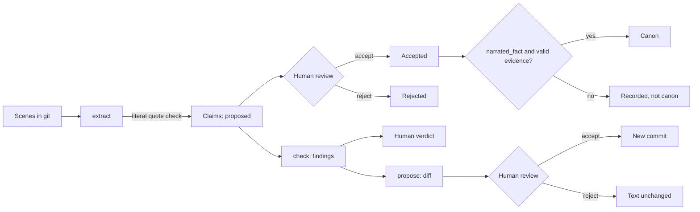

# MVP design: first vertical slice

## The goal

Show one complete path with human review: scenes, claims with evidence, a knowledge problem found with two quotes, a change reviewed as a diff, and state that survives closing and reopening.

## What this proves

| It proves | It does not prove |
| --- | --- |
| Quotes shown as literal exist in their file and revision | That a model can extract good claims |
| An edit never leaves evidence looking current | That a model can find knowledge problems in real prose |
| A rumor cannot reach canon by being accepted | That writers find this useful |
| Nothing changes the text without an explicit accept | That the check scales past one kind of problem |
| Retries do not duplicate records, and state restores from a clone | That Git and PRs are comfortable for writing |

The knowledge check only works because a person wrote the `knowledge` links in the fixture. **This slice tests the safety rails and the workflow, not the narrative intelligence.** That is the next thing to test.

## What is a stand-in

| Part | In this version | Later |
| --- | --- | --- |
| Claim extraction | `fixture-annotations`: reads hand-written JSON | A model returns the same `ClaimCandidate` shape and passes the same quote validation |
| Continuity check | One rule over annotated links | A model proposes links, and the rule stays as a mechanical guard |
| Revision text | Written by the person who runs `propose` | A model proposes it, and the review path stays the same |
| Evidence, states, diff, persistence | Real | Real |

Every claim records its `extractor`, so model output can be told apart from annotations later.

## Flow

## Decisions

1. **Two independent states.** `editorial_status` is what a person decided. `evidence_status` is whether the text still supports the claim. Accepting a claim says nothing about its evidence, and an edit changes nothing about the decision.
2. **Evidence status is derived, never stored.** It is recomputed from the text on every read, so a stored value can never go out of date and pass as current.
3. **Canon is a query, not a state.** A claim is canon when it is accepted, is a `narrated_fact`, and has valid evidence. A rumor has no path to canon, and a fact leaves canon as soon as its evidence breaks.
4. **Story time decides knowledge order, not reading order.** A flashback read later is not a leak. Each claim keeps `story_time` and `reveal_order` separately.
5. **Findings are heuristics.** They are `possible_contradiction` or `insufficient_evidence`, and they always list other readings, including deliberate mystery. A contradiction is claimed only when both quotes are current and the order is known. Otherwise the finding says the evidence is insufficient.
6. **Text and decision share one commit.** An accepted proposal cannot exist without its text change, or the reverse. The resulting commit is found from its subject, because a commit cannot contain its own hash.
7. **Ids come from content.** The same claim or the same change on the same base gets the same id, which makes retries harmless.
8. **State lives in the book repository.** `.rewrite/` holds one JSON file per record, and git versions it. A clone restores everything. SQLite was not needed.
9. **Domain before interface.** `src/domain` knows nothing about git, files or the CLI. The core functions are `readScene`, `extractClaims`, `inspectContinuity`, `proposeRevision` and `reviewProposal`, and the CLI, MCP server and review page all call them.
10. **TypeScript on Node 24.** Node runs it directly with no build step.

## Evidence rules

| What happened to the quote | Status | Reason |
| --- | --- | --- |
| Same place, same surrounding words | `valid` | `unchanged` |
| Moved, same surrounding words | `valid` | `relocated` |
| Still there, surrounding words changed | `stale` | `context_changed` |
| Appears several times, none in its context | `stale` | `ambiguous` |
| Gone | `orphaned` | `quote_not_found` |
| File deleted | `orphaned` | `file_missing` |
| Stored quote not in the recorded revision | `orphaned` | `quote_not_in_revision` |

A claim whose evidence is not `valid` cannot be accepted.

## Known limitations

- **Context is 32 characters on each side.** An edit further away can change the meaning, for example a new sentence that reveals a lie, and the evidence stays `valid`.
- **There is no way to re-anchor a claim.** A claim with broken evidence stays broken. Extracting the same statement and quote returns the existing record, so a replacement needs a new statement or quote.
- **Decisions are final.** A rejected claim or proposal cannot be reopened. A finding's verdict can be overwritten, and only git keeps the earlier one.
- **Proposals change one exact passage in one file.**
- **Only one kind of check exists:** knowledge order for one character and fact.
- **The fixture is synthetic.** It is a short invented story, not a real manuscript.
- **The golden set is the fixture itself,** and it was written by the same author as the code, so passing tests are not independent evidence of quality.

## Declared debt: secrets between coauthors

Everyone with access to a repository can read all of it. **This slice gives no protection for secrets between coauthors,** and a shared GitHub repository would not either. Real isolation needs separate access domains, and it needs negative tests before anyone relies on it.

## Next cut

The harness does not supply a model: whichever client connects does. The next question is whether such a client can do the part people did here. Give a clean agent the scenes without the annotations, and measure its output against them: quotes verified, epistemic kinds correct, and whether the seeded leak is found with no false positive on the baseline. This needs no API key in RE;write.
