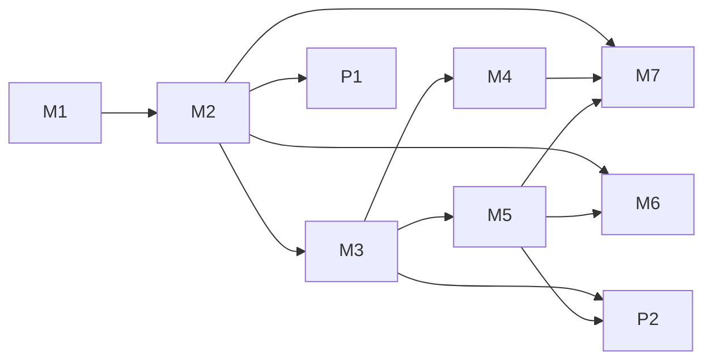

# Roadmap

RE;write is built as the second host of the Harness Composition Specification (HCS): see [ADR-0001](adr/0001-adopt-hcs.md) and [architecture.md](architecture.md). This page holds the gap map against HCS and the milestones with their issues.

HCS documents and requirements are cited by id (for example HCS-0003-R004). HCS is not public yet; its text is not reproduced here.

## Order

M1 and M2 come first: nothing else can load without a catalog and a lifecycle. M3 (authority) must land before any package reaches an engine. M4 (signed distribution) and M5 (projection) can run in parallel after M3. M6 follows M2 and grows with M5. M7 runs continuously from M2 and closes with the conformance report. Product milestones P1 and P2 build on the core: P1 features that are host core can start at any time; their analysis parts load as packages once M2 and M3 are done.

## Gap map

Status: **has** = present in the current slice; **partial** = the idea exists without the HCS form; **missing**; **n/a** = does not apply, with the reason.

| Document | What RE;write must do | Already has | Does not apply | Issues |
| --- | --- | --- | --- | --- |
| HCS-0000 Conventions | Declare `hcsVersion`; own the `x-rewrite` namespace; accept unknown `x-` members and never let them change a verdict (R003, R004 MUST) | missing | R001, R002 are process rules on the HCS repository, not on hosts | [#20](https://github.com/FullFran/re-write/issues/20), [#21](https://github.com/FullFran/re-write/issues/21), [#23](https://github.com/FullFran/re-write/issues/23) |
| HCS-0001 Catalog manifest | Validate documents (R001-R006, R011 MUST; R015 SHOULD), read `hcsVersion` first (R002), verify bytes before unpacking (R007), refuse unsupported kinds and media types (R008, R013), match hosts exactly (R016), never run package code while validating (R010), unpack OCI layers (R012); build packages deterministically (R014 SHOULD) | partial: content-derived ids, literal checks; no packages, no catalog | R009 platform checks apply trivially: packages are TypeScript and data with no platform list. Multi-platform entries (OQ-0001-2) do not matter for a server-only host | [#24](https://github.com/FullFran/re-write/issues/24), [#25](https://github.com/FullFran/re-write/issues/25), [#26](https://github.com/FullFran/re-write/issues/26), [#27](https://github.com/FullFran/re-write/issues/27) |
| HCS-0002 Capability ids | Use the grammar (R001), match by reference only (R002), majors are different contracts (R003); own `com.fullfran.rewrite` ids (R004, R005 SHOULD) | partial: MCP tool names, no capability ids | none | [#21](https://github.com/FullFran/re-write/issues/21) |
| HCS-0003 Resolution | Deterministic resolution without running code (R001), typed dependency errors (R002-R006), stable order (R007), declared policy `all-or-nothing` (R008, R009) | missing | R010 (`partial` policy) does not apply: RE;write declares `all-or-nothing` | [#27](https://github.com/FullFran/re-write/issues/27) |
| HCS-0004 Lifecycle | No code before `prepared` (R001), state names (R002), atomic transitions (R003), reverse stop order (R004), typed calls to inactive capabilities (R005), no calls while draining (R006), timeouts (R007); OpenTelemetry SHOULD (section 4) | partial: one process serializes writes; no states, no generations | none | [#29](https://github.com/FullFran/re-write/issues/29), [#10](https://github.com/FullFran/re-write/issues/10), [#42](https://github.com/FullFran/re-write/issues/42) |
| HCS-0005 Authority | Deny without a grant (R001), requests are never grants (R002), check at dispatch so revocation is immediate (R003), `x-` never grants (R004) | partial: per-person book access and two doors (MCP proposes, review decides); no package grants | none | [#30](https://github.com/FullFran/re-write/issues/30), [#31](https://github.com/FullFran/re-write/issues/31), [#4](https://github.com/FullFran/re-write/issues/4) |
| HCS-0006 Typed errors | HCS error objects (R001) from the closed set (R002), over JSON-RPC in `error.data.hcsError` (R003) and RFC 9457 (R004, R005) | partial: refusals with exit codes and messages; no HCS codes | none; product refusals stay outside the HCS code set by design | [#28](https://github.com/FullFran/re-write/issues/28) |
| HCS-0007 Signed catalog (DISTRO-1) | Verify envelopes and key sets in order (R001-R014), persist accepted state (R015), `all-or-nothing` (R016), never modify active content (R017), roll back on failed health (R018); offline root, provenance, CloudEvents reports (R019-R021 SHOULD) | missing; deployment is an image tag | `binding` has a single assignment (one deployment); it still applies and is checked | [#32](https://github.com/FullFran/re-write/issues/32), [#33](https://github.com/FullFran/re-write/issues/33), [#34](https://github.com/FullFran/re-write/issues/34), [#9](https://github.com/FullFran/re-write/issues/9), [#43](https://github.com/FullFran/re-write/issues/43) |
| HCS-0008 Host adapter (Provisional) | One generation per run (R001, R002), every contribution projected or reported (R003-R005, R017), collisions (R006), host-owned settings win (R007), skills unchanged (R008, R009 SHOULD), `server.json` with secrets from grants (R010-R012), confirm after health with one rollback (R013-R016), health states (R018 SHOULD) | partial: MCP server with fixed tools and instructions; `/llms.txt` onboarding | Connected MCP clients are not engines RE;write starts: R001, R002 and R013-R016 apply by analogy (per MCP session); R014 applies only to the embedded engine. Appendix A mappings for engines RE;write does not run are informative only | [#35](https://github.com/FullFran/re-write/issues/35), [#36](https://github.com/FullFran/re-write/issues/36), [#37](https://github.com/FullFran/re-write/issues/37), [#38](https://github.com/FullFran/re-write/issues/38), [#39](https://github.com/FullFran/re-write/issues/39), [#40](https://github.com/FullFran/re-write/issues/40), [#41](https://github.com/FullFran/re-write/issues/41), [#5](https://github.com/FullFran/re-write/issues/5), [#7](https://github.com/FullFran/re-write/issues/7) |
| Conformance | Run the reference cases against RE;write as system under test, add host cases, publish a report | missing; tests cover the domain only | none | [#44](https://github.com/FullFran/re-write/issues/44), [#45](https://github.com/FullFran/re-write/issues/45), [#46](https://github.com/FullFran/re-write/issues/46), [#8](https://github.com/FullFran/re-write/issues/8) |

## Existing issues placed in this plan

The seven issues opened from the first host's evidence ([#4](https://github.com/FullFran/re-write/issues/4) to [#10](https://github.com/FullFran/re-write/issues/10)) carry the `spec-gap` label: their spec questions belong to HCS, and the RE;write work that depends on them links them. The vision and feature issues ([#11](https://github.com/FullFran/re-write/issues/11) to [#19](https://github.com/FullFran/re-write/issues/19)) and the first three issues ([#1](https://github.com/FullFran/re-write/issues/1) to [#3](https://github.com/FullFran/re-write/issues/3)) carry a design-fit comment and sit in M3, P1 or P2. The milestone "Rewrite (weekend 2026-11-07)" is now empty; its issues moved to the milestone of the layer they belong to.

## Milestones and issues

### [M1 Foundation: adopt HCS](https://github.com/FullFran/re-write/milestone/2)

Pin the HCS contract, reserve the x-rewrite namespace and com.fullfran.rewrite ids, and name re-write's composable units.

**Exit:** ADR-0001 accepted, ids and namespace documented, units mapped to contribution kinds, traceability matrix in docs.

- [#20](https://github.com/FullFran/re-write/issues/20) chore: consume a pinned HCS contract (schemas, requirements, runner) without publishing private text
- [#21](https://github.com/FullFran/re-write/issues/21) feat: reserve the x-rewrite extension namespace and com.fullfran.rewrite capability and permission ids
- [#22](https://github.com/FullFran/re-write/issues/22) design: map re-write's composable units onto HCS contribution kinds
- [#23](https://github.com/FullFran/re-write/issues/23) docs: requirement traceability matrix from HCS requirement ids to re-write code and tests

### [M2 Core: catalog, resolution, lifecycle (CORE-0)](https://github.com/FullFran/re-write/milestone/3)

re-write reads a catalog of its own packages, verifies and unpacks them, resolves them deterministically, moves through HCS-0004 states atomically and reports HCS-0006 errors over MCP and HTTP.

**Exit:** every CORE-0 requirement has a re-write implementation and a passing case.

- [#10](https://github.com/FullFran/re-write/issues/10) spec: host serialization of update work and out-of-band modification (OQ-0004-6)
- [#24](https://github.com/FullFran/re-write/issues/24) feat: package builder producing deterministic OCI layers with contentHash and size
- [#25](https://github.com/FullFran/re-write/issues/25) feat: read and validate catalog manifests before anything runs
- [#26](https://github.com/FullFran/re-write/issues/26) feat: verify package bytes before unpacking and unpack safely
- [#27](https://github.com/FullFran/re-write/issues/27) feat: deterministic resolution with eligibility checks and a declared activation policy
- [#28](https://github.com/FullFran/re-write/issues/28) feat: typed HCS errors over MCP (error.data.hcsError) and HTTP (RFC 9457)
- [#29](https://github.com/FullFran/re-write/issues/29) feat: entry lifecycle and atomic desired-set transitions over generation directories

### [M3 Authority: requests, grants, subjects](https://github.com/FullFran/re-write/milestone/4)

Packages request permissions, the host grants them, every operation is checked at dispatch, and per-person book access joins package grants in one decision point. Approval stays human-only.

**Exit:** HCS-0005 R001-R004 pass, including the host-level revocation case.

- [#1](https://github.com/FullFran/re-write/issues/1) Exercise backup, restore, and cross-book authorization before private manuscripts
- [#4](https://github.com/FullFran/re-write/issues/4) spec: per-subject credential delivery to projected MCP servers (OQ-0005-2, OQ-0005-5)
- [#30](https://github.com/FullFran/re-write/issues/30) feat: package permission requests, host grants and checks at dispatch
- [#31](https://github.com/FullFran/re-write/issues/31) feat: one decision point for person-to-book access and package grants

### [M4 Distribution: signed catalog (DISTRO-1)](https://github.com/FullFran/re-write/milestone/5)

re-write accepts only signed, current, correctly bound catalogs, keeps accepted state across restarts and switches generations as one step.

**Exit:** every DISTRO-1 case passes, keys have a custody record, publishing is scripted.

- [#9](https://github.com/FullFran/re-write/issues/9) docs: key custody and lifetimes in practice (OQ-0007-2, OQ-0007-6)
- [#32](https://github.com/FullFran/re-write/issues/32) feat: verify signed catalog envelopes and key sets (DISTRO-1)
- [#33](https://github.com/FullFran/re-write/issues/33) feat: persist accepted catalog state and switch generations only after full verification
- [#34](https://github.com/FullFran/re-write/issues/34) feat: publishing tool for signed catalogs, key sets and provenance

### [M5 Host adapter: projection into engines](https://github.com/FullFran/re-write/milestone/6)

Each active generation is projected, whole and pinned, into the engines re-write serves: connected MCP clients first, an embedded engine for non-technical writers second; every contribution is projected or reported and host-owned settings win.

**Exit:** HCS-0008 projection cases pass and a generation is confirmed only after a healthy run.

- [#5](https://github.com/FullFran/re-write/issues/5) spec: host-owned settings vocabulary incl. model allowlist per engine (OQ-0008-2)
- [#7](https://github.com/FullFran/re-write/issues/7) spec: session-scoped engine process and turn latency phases (OQ-0004-2, OQ-0004-4)
- [#35](https://github.com/FullFran/re-write/issues/35) design: which engines re-write projects into and how a generation reaches each
- [#36](https://github.com/FullFran/re-write/issues/36) feat: project the active generation into each MCP session, pinned for the session
- [#37](https://github.com/FullFran/re-write/issues/37) feat: host-owned settings win and name collisions are refused
- [#38](https://github.com/FullFran/re-write/issues/38) feat: deliver skill contributions unchanged to connected agents
- [#39](https://github.com/FullFran/re-write/issues/39) feat: mcp-server contributions as server.json with secrets only from grants
- [#40](https://github.com/FullFran/re-write/issues/40) feat: embedded engine adapter for writers without their own agent
- [#41](https://github.com/FullFran/re-write/issues/41) feat: confirm a generation only after a healthy run, with exactly one rollback

### [M6 Observability](https://github.com/FullFran/re-write/milestone/7)

OpenTelemetry traces and status reports with stable names, privacy levels that never let manuscript text leave, and typed errors mapped to error.type.

**Exit:** one traced MCP turn and one lifecycle transition are visible end to end at the metadata level with no manuscript text.

- [#6](https://github.com/FullFran/re-write/issues/6) spec: observability profile on OpenTelemetry (levels off/metadata/masked, allowlist, feedback events) (OQ-0006-3, OQ-0004-3, OQ-0007-3)
- [#42](https://github.com/FullFran/re-write/issues/42) feat: OpenTelemetry traces for MCP calls and lifecycle transitions with privacy levels
- [#43](https://github.com/FullFran/re-write/issues/43) feat: status reports as CloudEvents with HCS-0004 status data

### [M7 Conformance: second host claim](https://github.com/FullFran/re-write/milestone/8)

Run the HCS reference cases against re-write as system under test, add the host-level cases it can run, and publish a conformance report.

**Exit:** a report showing CORE-0 passed, then DISTRO-1, with pending host cases listed.

- [#8](https://github.com/FullFran/re-write/issues/8) conformance: cases from the server-side box host (confirm after a healthy turn, one rollback, unprojectable kinds)
- [#44](https://github.com/FullFran/re-write/issues/44) ci: run the HCS reference cases against re-write as system under test
- [#45](https://github.com/FullFran/re-write/issues/45) test: host-level cases re-write can run (lifecycle, revocation, restarts, projection, health)
- [#46](https://github.com/FullFran/re-write/issues/46) docs: publish the re-write conformance report and claim CORE-0, then DISTRO-1

### [P1 Narrative model on the HCS host](https://github.com/FullFran/re-write/milestone/9)

Product features of the writing domain, built as host core (narrative model, review door, versions) or as packages (checks, extractors) on the HCS foundation.

**Exit:** each feature has synthetic tests, keeps human-only approval, and its analysis parts load as packages through M2 to M5.

- [#2](https://github.com/FullFran/re-write/issues/2) Validate human review end to end, including stale and concurrent changes
- [#3](https://github.com/FullFran/re-write/issues/3) Build reproducible synthetic extraction and continuity evaluation
- [#11](https://github.com/FullFran/re-write/issues/11) Support re-anchoring and reopening editorial decisions
- [#12](https://github.com/FullFran/re-write/issues/12) Add stable narrative entities and evidence-backed relationships
- [#13](https://github.com/FullFran/re-write/issues/13) Represent manuscript versions and separate narrative canon
- [#14](https://github.com/FullFran/re-write/issues/14) Model character, reader and narrator knowledge separately
- [#15](https://github.com/FullFran/re-write/issues/15) Provide an evidence-backed timeline and event navigation
- [#18](https://github.com/FullFran/re-write/issues/18) Search evidence and review editorial findings

### [P2 Writer workspace and integrations](https://github.com/FullFran/re-write/milestone/10)

What a writer without Git uses: a workspace around the review flow, imports and exports, and exploratory craft diagnostics, each fitted to the HCS design (importers and diagnostics as packages with permission requests).

**Exit:** one import, review and reload path works for a non-technical writer on synthetic text.

- [#16](https://github.com/FullFran/re-write/issues/16) Design a safe, incremental Notion import and export mapping
- [#17](https://github.com/FullFran/re-write/issues/17) Build a usable manuscript workspace around the review flow
- [#19](https://github.com/FullFran/re-write/issues/19) Explore scene planning and explainable craft diagnostics

